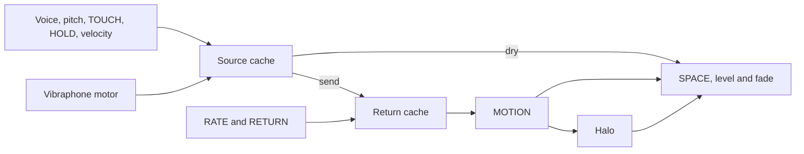

# HALOBAR control-edit playability

The new source and unmodulated-return caches reduce repeated work during control
edits while retaining the six approved voice banks. All 408 published Float32
fixtures and 72 additional take cases remain exact on the same JVM. The audio
model, recipes, factory registry and export behavior are unchanged.

Measured production/test source: `05ff0aa17a25d40e2f638c1be05961236075e70b`. Baseline: `20833d96949c2d13c389c03da1faaa7587259e13`. The shared FFT,
resampler, filters and output-stage sources are identical between these versions.

MOTION medians fell 61–67% for the five voices without a source motor. RATE and
RETURN edits generally improved. Vibraphone MOTION was 5.8% slower in this run:
its amplitude-modulated body must be rebuilt when the motor changes, so those
edits cannot use the source/return shortcut. Fresh
renders still take 130–301 ms at their medians and miss the 50 ms target. Tail
latency is mixed. These desktop measurements do not establish phone latency.

## Fresh render

| Voice | Before median / p95, ms | After median / p95, ms | Median change |
|---|---:|---:|---:|
| Vibraphone | 304.3 / 347.2 | 294.2 / 388.0 | -3.3% |
| Marimba | 172.0 / 195.5 | 165.4 / 200.7 | -3.9% |
| Xylophone | 144.0 / 235.9 | 130.1 / 143.9 | -9.7% |
| Glockenspiel | 229.7 / 288.1 | 209.4 / 225.4 | -8.8% |
| Crotales | 287.4 / 398.2 | 272.2 / 292.8 | -5.3% |
| Tubular bells | 315.2 / 343.6 | 301.3 / 335.2 | -4.4% |

## RATE edits across six divisions

| Voice | Before median / p95, ms | After median / p95, ms | Median change |
|---|---:|---:|---:|
| Vibraphone | 286.7 / 456.6 | 240.3 / 354.8 | -16.2% |
| Marimba | 158.8 / 214.4 | 134.2 / 153.3 | -15.5% |
| Xylophone | 128.0 / 233.1 | 54.4 / 73.2 | -57.5% |
| Glockenspiel | 210.7 / 276.5 | 166.8 / 185.1 | -20.8% |
| Crotales | 267.0 / 346.4 | 210.0 / 289.4 | -21.4% |
| Tubular bells | 320.9 / 346.2 | 233.7 / 299.8 | -27.2% |

## RETURN edits

| Voice | Before median / p95, ms | After median / p95, ms | Median change |
|---|---:|---:|---:|
| Vibraphone | 297.6 / 319.1 | 240.7 / 306.3 | -19.1% |
| Marimba | 166.6 / 189.2 | 141.6 / 153.1 | -15.0% |
| Xylophone | 143.0 / 286.2 | 120.8 / 135.0 | -15.5% |
| Glockenspiel | 210.6 / 249.0 | 173.1 / 184.9 | -17.8% |
| Crotales | 287.3 / 358.7 | 216.8 / 251.8 | -24.5% |
| Tubular bells | 311.6 / 607.3 | 247.4 / 412.4 | -20.6% |

## MOTION edits

| Voice | Before median / p95, ms | After median / p95, ms | Median change |
|---|---:|---:|---:|
| Vibraphone | 297.0 / 472.2 | 314.1 / 372.3 | +5.8% |
| Marimba | 169.5 / 194.9 | 66.5 / 79.2 | -60.8% |
| Xylophone | 154.8 / 220.2 | 57.0 / 86.9 | -63.2% |
| Glockenspiel | 225.6 / 253.0 | 78.4 / 86.3 | -65.3% |
| Crotales | 289.7 / 343.3 | 98.4 / 108.8 | -66.0% |
| Tubular bells | 315.6 / 377.7 | 103.0 / 177.1 | -67.4% |

## Prepared positive-SPACE edits

| Voice | Before median / p95, ms | After median / p95, ms | Median change |
|---|---:|---:|---:|
| Vibraphone | 14.2 / 24.2 | 14.4 / 20.4 | +0.9% |
| Marimba | 9.1 / 15.7 | 8.8 / 13.1 | -2.7% |
| Xylophone | 7.7 / 14.9 | 7.3 / 12.3 | -4.6% |
| Glockenspiel | 10.6 / 17.7 | 10.6 / 16.4 | -0.3% |
| Crotales | 12.9 / 18.5 | 12.9 / 19.8 | +0.3% |
| Tubular bells | 13.4 / 21.0 | 13.7 / 20.2 | +1.7% |

## Timing protocol

The isolated before/after/after/before comparison runs separate Java 21.0.13+9
JVMs with a 1 GB G1 heap, four logical processors and one parallel/concurrent GC
worker. All threads are pinned to CPU 0; other build and test workers
were stopped. There are eight warmups and eighteen measurements per case per
round, yielding 36 measurements per voice/control/version. Raw wall and
thread-CPU samples are in `reference/halobar/playability/benchmark-results.json`.

Fresh cases clear every completed, stem, source and return cache before each
render. Other cases begin from a cleared cache and use full velocity and the
default recipe except for the named control. RATE cycles through all six real
divisions with unique raw knob values; the new canonical division key can retain
multiple divisions where the byte budget permits, so this includes revisits.
RETURN, MOTION and SPACE measurements use unique values from approximately
0.196 to 0.4 after warmup. They do not measure the entire control cube. SPACE
remains positive. Repeated completed-audio hits do not satisfy these cases.
The progress-print variable was renamed after execution; raw filenames and phase
grouping were verified and all cases contain 36 before and 36 after samples.

Baseline HALOBAR was compiled from the exact baseline source with the same
Kotlin 2.0.21/JVM-17 target and unchanged shared DSP dependencies. The Java
benchmark driver is included beside the data. Apparent cold-render gains are
reported as measurements, not as evidence that cache hits meet a cold budget.

## What is reused

The finite source depends on voice, sounding MIDI note, TOUCH, effective HOLD,
velocity and, for vibraphone only, MOTION. The cache also keys its dry-buffer
length. It retains the downsampled dry body and the finite raw send; subsequent
send frames are reconstructed as the original exact positive zeros.

The unmodulated return additionally depends on the delay division, RETURN and
frame count. Each render copies its echo before phase motion and convolution;
finishing owns a new output. Cached arrays are private and immutable. SPACE=0,
fresh diagnostic probes and later native landings retain the uncached path.
Clear-cache measurements clear every layer. Completed valid stages may be kept
when later work is cancelled; incomplete stages are never published.

Each new stage has an 8 MiB audio-array budget with LRU eviction. Together with
the prior 6 MiB completed and 8 MiB stem budgets, the conservative sum is now
30 MiB, an additional 16 MiB. Some arrays are shared between stages. This is an
audio-cache budget, not a total application-heap bound; device memory and timing
still need measurement.

Four new tests cover exact uncached comparisons over every source/return
control and velocity, concurrent motion/delay edits, bounded eviction, caller
ownership, cancellation and nonreference-take isolation. Independent external
copies with only the TOUCH source key, RETURN key or vibraphone motor key
removed each fail a named stale-audio oracle. Retained keys pass. Production
source and tests are never modified by those mutation checks.

The full nine-module local repository CI gate passed 9,735 tests,
with zero failures, errors or skips. All 643
synthesis test classes ran exactly once across the three repository CI shards.
Android assembly and device-test compilation passed; the APK v2 signature is
verified. Device instrumentation was not executed.

## Performance review and remaining gates

[The private performance review](https://halobar-native-audition.bertcalm.chatgpt.site/tubular-bells/performance/review/) groups the sixteen-pad kit,
chords, touch/release examples, rolls and risers. The kit was saved, reloaded and
rendered through shared pad selection and gains. Both MPC descriptor formats
passed software read-back; all sixteen PCM24 samples match the existing study
kit download. All seventeen new lossless FLAC files decode to their source
PCM16 exactly. Existing bank audio and downloads are unchanged. Browser QA was
not executed because the managed browser-control tool was unavailable; native
Sites publication succeeded.

The six voice banks retain owner listening approval from the prior build.
Performance-example approval is recorded separately: Awaiting owner listening verdict.
No Android device or emulator was available. Physical phone playback and MPC
loading remain unverified. Combined MPC keygroup velocity/round robin still
needs the firmware bench: the existing diagnostic compares velocity-only,
cycle-only and combined candidates. The repository's missing chain-WAV slice
map capture remains HH1.4; no unproven mode is enabled. The production keygroup
fallback still exports each velocity level's first take, so it does not close
that export gate.

Why it is built this way:

- Reuse only the stages whose sound inputs did not change; preserve source motor behavior on vibraphone.
- Copy at mutable boundaries so parallel edits and earlier returned notes remain independent.
- Bound the additional memory and keep truly fresh timings separate from reused stages.
- Preserve approved audio and leave hardware/format limits explicit while they lack evidence.
