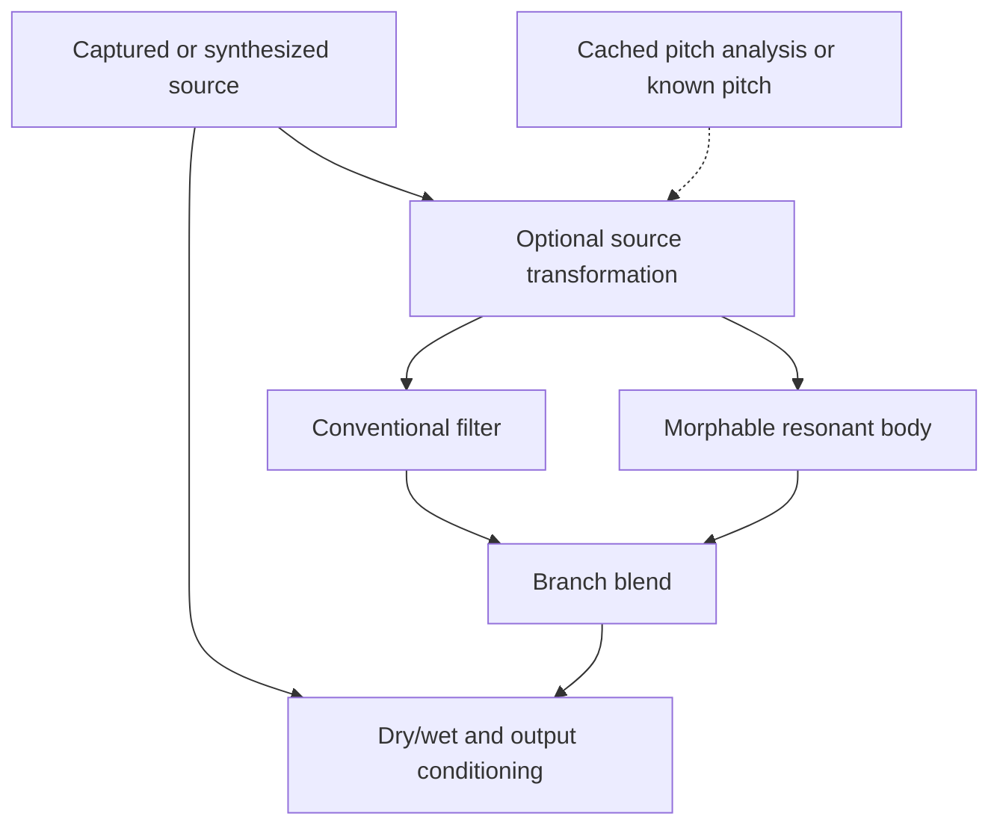

# Adaptation brief

Status: original R0 proposal. No audio had been rendered or heard when prepared. R1 implementation and measurements are recorded in the [As built ledger](r1-implementation-plan.md#as-built-r1). Code facts below were read at `565551e7974a4c61954199fac56a7a8d3dd502ed` and rechecked in the R0 review.

The characteristic gesture is **recognizable source attack → transformed cycle structure → changing resonant body → controlled ringing release**.

## What to take from each reference

Manipulator's essence: pitch-informed granular processing changes pitch, formants, and cycle organization, with harmonic displacement tied to the source fundamental.

Supermodal's essence: an input excites a morphable bank of resonances, blended with a conventional filter in parallel.

These are behavior references. The manuals do not disclose complete proprietary algorithms or measured modal tables. Our implementation, models, interpolation, and parameter laws remain proposals. Material and vocal labels describe intended perceptual character, not complete physical or anatomical simulation.

| Reference behavior | Evidence in supplied manual | Proposed adaptation |
|---|---|---|
| Pitch and formant independently controlled | Manipulator pp. 12–13 | Independent note and spectral-envelope controls for a captured monophonic sound. Treat naturalness as an audition question. |
| Downward grain smoothing | Manipulator p. 12 | Adjustable overlap/fill behavior; the manual says this control does not affect upward shifting. Do not assume arbitrary granular smoothing is equivalent. |
| Harmonic displacement relative to detected pitch | Manipulator pp. 14–15 | Pitch-tracked frequency translation with a separately defined ratio law. Fractional harmonic steps in the reference crossfade integer-step results; they are not simply a fractional frequency offset. |
| Alternating transposition on cycle groups | Manipulator p. 16 | Pitch-synchronous grains alternating upward/downward playback ratios. Grain length in source cycles is the distinguishing behavior. |
| Smear precedes main algorithms | Manipulator p. 17 | Evaluate reuse of existing smear, but verify its mechanism and placement before calling it equivalent. |
| Parallel classic and modal filters | Supermodal pp. 13–18 | A filtered-source branch and a resonant-body branch with an explicit blend. This is distinct from serial filtering of the modal output. |
| Model and variation morphing | Supermodal pp. 18–21 | A small authored set of mode tables with predictable interpolation; no attempt to reproduce all 27 reference configurations. |
| Modal decay, damping, partial limits | Supermodal pp. 18, 21 | Per-mode decay plus separate high-mode attenuation and frequency-range controls. Do not conflate amplitude rolloff with decay-time damping. |
| Variable filter counts | Supermodal p. 45 | Benchmark small banks before increasing count. The reference's 32/64/100 filters per side are quality settings, not a requirement. |
| Modulation and macros | Both manuals' modulation sections | A few deterministic envelopes or patterns baked into the render; no full modulation matrix initially. |

Manipulator's four-voice MIDI harmonization and Supermodal's host-synced modulation are deferred. SnipSnap's offline path has no equivalent live performance contract. Stereo is optional scope, not impossible: synth renders are mono but the existing rack can widen and preserve stereo.

## Repository fit

| Inspected source | Verified baseline behavior | Consequence |
|---|---|---|
| `audio/src/main/kotlin/com/snipsnap/audio/Body.kt` | Chord-tone resonators over three octaves; one shared T60; wet peak matching; accepts source sample rate and channels; appends decay frames. | Closest capture-side starting point, but not a morphable material bank. Preserve existing behavior or version any replacement. |
| `synth/src/main/kotlin/com/snipsnap/synth/Modes.kt` | Internal toolkit with per-mode ratio/gain/T60; `ring` has fixed coefficients for each mode during a call, uses plain modal gain, and skips out-of-Nyquist modes. | Useful primitives, not a ready-made time-varying body processor. It is `internal` in `:synth`, so `:audio` cannot simply call it. |
| `synth/src/main/kotlin/com/snipsnap/synth/Grains.kt` | Source slices of 15–250 ms, Hann windows, linear resampling, seeded scatter, pitch and octave-up layer; converts input to mono. | Existing source-resynthesis path, but no pitch-synchronous segmentation or independent formant preservation in this implementation. |
| `synth/src/main/kotlin/com/snipsnap/synth/FxChain.kt` | Fixed section order, null hard bypass, editable JSON recipe, channel-preserving downstream stages, and a total added-tail cap. | Additions need an explicit order and compatibility plan. Long resonance cannot bypass the rack's one-second tail policy silently. |

The Luthier inventory additionally identifies VOX/MURMUR as vocal-generation relatives and MERCURY/TESSERA as modal-body relatives. Those are inventory-level comparisons, not fresh code audits in this handoff. Verify them before claiming an architectural gap. BODY and GRAINS are the nearest directly inspected processing relatives; neither currently combines cycle-aware transformation with body morphing.

## Three directions

Scores are qualitative judgments, not measurements or time estimates.

1. **Strong / STACK:** two independently usable processors plus combined recipes. Gesture clarity high; novelty high for source processing; risk moderate-to-high, dominated by pitch tracking; cost medium-to-high across staged rounds. Wins because it benefits captures and existing engines without requiring a new source engine.
2. **Alternative / SPLICE:** put cycle transformation into an existing vocal engine and selected body morphs into existing instruments. Gesture clarity high; novelty moderate; risk moderate; initial cost lower. Known source pitch helps, but arbitrary captured sources remain unsupported.
3. **Experimental / COUPLE:** source energy controls body morph while body-energy descriptors control later grain changes. Gesture clarity moderate; novelty high; risk and cost high. Defer until feed-forward stages work; any audio feedback would need a separate stability argument.

## Proposed strong architecture

This is a proposed conceptual topology, not an exact rack insertion plan. Both filter branches receive the transformed source. Bypass must avoid analysis and processing. Compensate any differential latency before dry/wet blending. Use one explicit final gain policy; serial per-stage normalization must not erase meaningful dynamics. No audio feedback in the first version.

For the R1 body-only proof, bypass source transformation and omit the conventional filter branch. Audition the original dry source, each bank, their static crossfade, and dry/wet mixtures separately. This deliberately proves only the resonant-body part of the reference topology. A conventional parallel filter and smooth movement during a render are subsequent gates; see the [R1 implementation plan](r1-implementation-plan.md).

## Macro direction

The eventual combined recipe could expose TUNE, SIZE, SHIFT, SPLIT, BODY, and RING. These are a design sketch, not a frozen schema. BODY denotes spectral interpolation, not mere wet gain; SIZE denotes spectral-envelope scaling, not sample speed. The first body processor needs its own small control contract, and should not carry inactive source-transform controls.

Do not invent HOLD functionality for a rack section. Long tails and a sustained periodic loop are different deliverables. A future engine wrapper requires its own HOLD and classifier contracts.

## Why it is built this way

- Separate processors are useful across many sources and easier to validate independently.
- Keeping an adjustable dry attack preserves the capture's rhythmic identity when resonance masks it.
- Body processing can be proven before unreliable source pitch estimates become a dependency.
- Parallel ordinary filtering supplies a recognizable source branch under strong resonances.
- The largest later risk is incorrect pitch tracking through consonants, transients, chords, and pitch transitions; confidence-aware fallback is part of the design, not polish.
